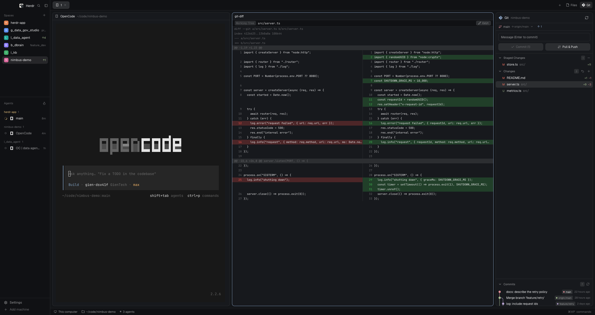

# Herdr 桌面增强 mods · Herdr Desktop Mods

> 一套 [Herdr](https://herdr.dev) 自定义 mod + 窗口布局：除了 Git 工作台（VS Code 风格的源代码管理面板、并排 diff、就地编辑、分支切换），还带来了更完整的文件管理（多选、右键菜单、重命名/复制/粘贴/删除、按类型着色的文件图标、图片预览）和改版的 Agents 列表、标签栏、可收成图标栏的侧栏与状态栏（含 opencode 提问）。
>
> A set of custom [Herdr](https://herdr.dev) mods plus a window layout: a Git workspace (a VS Code-style Source Control panel, side-by-side diffs, in-place editing, branch switching) — and beyond Git, a fuller file manager (selection, context menu, rename/copy/paste/delete, file-type icons, image preview) and a reworked agents list, tab bar, collapsible icon-rail sidebar and status bar (with the opencode prompt).

[中文](#zh) · [English](#en)



---

<a id="zh"></a>

## 中文说明

### 这是什么

本仓库是 Herdr 的个性化扩展，包含两部分：

- `mods/` 下的 9 个 mod：自己编写，或基于 Herdr 自带 mod 改编；
- `layouts/herdr-git.json`：把它们组装成完整工作台的窗口布局（由自带 `main` 布局克隆而来）。

仓库结构与 Herdr 的配置目录（默认 `~/.config/herdr-app/`）一一对应，可以按需复制进去使用。仓库只跟踪我们自己的文件；Herdr 自带的 mod、布局、窗口状态都不在其中（见 `.gitignore`）。Herdr 自带的功能（spaces、changes、pane、win98 等）不属于本项目。

对自带 mod 的改动都以**克隆**形式存在：Agents 列表的改版是 `agents-left`，Files 面板的改版是 `files-menu`，侧栏的改版是 `spaces-rail` 和 `workspace-chrome-rail`（另有 `tabs-git`、`status-branch`）——仓库跟踪与维护的正是这些克隆；Herdr 每次启动会重写或还原的原版副本（`mods/agents`、`mods/files` 等）不纳入版本管理。

装上这个布局后，窗口是这样的：

| 区域 | 内容 |
|---|---|
| 左侧栏 | 空间列表（`spaces-rail`）、Agents 列表（`agents-left`）、底部工具条（`workspace-chrome-rail`）；窄于 160px 时切换为图标栏（收起时为 52px） |
| 顶部 | 标签栏（`tabs-git`）：标签 + Files / Git 面板开关；Git 开关带待处理文件数徽标 |
| 主区 | 终端 / diff / 编辑器 / 图片标签页，面板带常显的标题栏 |
| 右侧栏 | Files / Git 面板轮换（`files-menu`、`git`） |
| 底部 | 状态栏（`status-branch`）：分支切换、实时目录、opencode 最后一条提问 |

### 9 个 mod

| mod | 来源 | 作用 |
|---|---|---|
| `git` | 全新 | 源代码管理面板：提交框、Staged/Changes、分支与 upstream、提交历史图 |
| `git-diff` | 全新 | diff 标签页：并排对比 / 单栏折叠，可从 diff 转入编辑 |
| `file-view` | 全新 | 文件编辑 / 图片查看标签页（从 Files 面板打开） |
| `files-menu` | 基于自带 `files` 改编 | 文件浏览器：多选、右键菜单、重命名/复制/粘贴/删除、类型图标、Git 状态标记 |
| `status-branch` | 基于自带 `workspace-status` 改编 | 状态栏：分支切换、实时目录、opencode 提问 |
| `agents-left` | 基于自带 `agents` 改编 | 状态图标前置、去掉标题命令前缀的 Agents 列表 |
| `tabs-git` | 基于自带 `tabs` 改编 | 标签栏上的 Files / Git 面板开关（Git 带待处理数徽标） |
| `spaces-rail` | 基于自带 `spaces` 改编 | 空间列表：窄栏时显示彩色首字母、状态点与对齐的编号 |
| `workspace-chrome-rail` | 基于自带 `workspace-chrome` 改编 | 52px 侧栏工具条：去掉 logo / 字标，收起时只留图标 |

#### `git` — 源代码管理面板

- **提交**：提交框支持 `Commit`（暂存区为空时相当于 VS Code 的 “全部提交”）和 `Pull & Push`（不是提交，空消息也能按）：pull 用 `--rebase --autostash`，分叉时把本地提交重放到远端之上、未提交改动自动暂存并恢复；冲突或恢复失败就停下并显示 git 报错，不推送。Cmd/Ctrl+Enter 直接提交。没有 upstream 时按钮只做推送（首次推送并设置 upstream），分支行仍显示 `Publish`。运行中的写入会让按钮图标变成旋转弧线——Commit、Pull & Push、ahead/behind 计数和 Publish 都一样，慢操作不会看起来像卡住。
- **暂存**：`Staged Changes` / `Changes` 两组可折叠；每行显示状态字母（M/A/D/U/R/!）、路径与 +/− 行数；悬停出现按钮：暂存 / 取消暂存 / 丢弃（丢弃需点第二次确认；整组丢弃有确认弹窗）。
- **分支**：分支行显示当前分支（按分支配色）、upstream、ahead/behind 计数（点击即 push / pull，pull 用 `--ff-only`）。
- **分支列表**：点分支名展开（本地 / Remote 分组），可多选；提交历史会收缩为所选分支能到达的提交，不选 = 全部分支。
- **提交历史**：最多 120 条，涵盖所有本地与远程分支；每行有手绘的提交图（泳道、分支色、分叉/合并的曲线），悬停展开完整信息卡，点击弹出该提交的消息 + 变更文件浮层（再点、Esc 或点别处关闭）；右键可 `Copy Hash`、在该提交上 `Create Branch…`。Commits 标题右侧的箭头有三档：完整高度 → 只显示最新 3 条 → 收起（只留标题）；拖拽折叠状态的上边缘会直接展开，展开后的高度会被记住。
- **看 diff**：点击文件不在这里画 diff，而是交给主区的独立 `git-diff` 标签页：每个空间只保留一个 diff 标签，换文件就地更新并切到该标签，再点同一文件即关闭标签页。
- **待处理数**：面板把 Staged / Changes 里的文件数（每个文件只算一次）发布到共享状态，标签栏的 Git 按钮因此带一个数字徽标；超过 99 显示 `99+`，悬停显示 staged / changes 明细，没有仓库或没有改动时徽标消失。
- **报错**：写入失败时 git 自己的报错显示在面板底部的横条里，点 `×` 或按 Esc 收起；下一次写入会替换它。
- **初始化**：文件夹还不是仓库时显示空状态，一个按钮执行 `git init`。
- 面板跟随当前聚焦终端的目录；远程 space 就在那台机器执行 git。所有读取带 `--no-optional-locks` 等参数，不会自己触发文件监视刷新。

#### `git-diff` — diff 标签页

- 作为主区的独立标签页打开：同一空间只有一个 diff 标签，换文件就地更新并以文件名命名标签；再点当前文件关闭标签页。
- 宽面板并排显示（左旧右新，被替换的删除行与新增行同行对齐）；面板窄于阈值时折叠成单栏统一视图，行不会被挤扁。
- 新文件（整列绿色）或删除文件（整列红色）始终单栏；hunk 头与文件元信息整行显示。
- 头部 `Edit` 按钮就地切换为编辑器：保存前校验文件自读取后未被改动（否则拒绝），带未保存修改离开会先询问一次。提交的 diff 也能进入编辑——编辑的是工作区副本，diff 仍显示提交版本。
- 单次对比有上限（600 KB patch / 4000 行）；二进制文件与远程机器上的文件不可编辑。

#### `file-view` — 文件编辑 / 图片查看标签页

- 从 Files 面板点击文件在独立标签页打开；同一空间只有一个文件标签，换文件就地更新，标签名随文件名。文本文件是编辑器，头部右上角 `Save` 保存，同样带“读后被改动则拒绝”的保护。
- PNG / JPEG / GIF / WebP / BMP / ICO / SVG 直接显示图片：默认缩放到面板内，点击图片或标题栏的 `1:1` / `Fit` 按钮在原始尺寸与适应窗口之间切换（原始尺寸超出面板时滚动查看）；像素尺寸从文件头读取。图片会复制到配置目录的 `data/file-view/` 下（保留最近 16 份），本机超过 32 MiB、远程超过 6 MiB 的图片不预览。
- 文本文件大于 1 MiB 或位于其他机器时以只读方式打开（无法安全回写）。
- 编辑器有未保存修改时，切换文件会等待而不是丢弃编辑；点击当前显示的文件会收起该标签页。

#### `files-menu` — 文件管理

- 行选择：Cmd/Ctrl+单击多选、Shift+单击范围选择，右键菜单作用于整个选择；普通点击保持原行为（文件夹展开/收起，文件在 `file-view` 标签页打开/关闭）。
- 每个文件按类型显示自己的图标和主题色（Markdown、JSON、配置、样式、代码、脚本、数据库、图片、音视频、压缩包……），文件夹显示展开箭头；打开中的文件用强调色，删除确认框里的文件也带同样的图标。
- 文件右键菜单：用系统缺省应用打开、在标签页中打开、重命名、复制、剪切、粘贴、复制路径、删除；文件夹菜单另有新建文件 / 新建文件夹；面板空白处是整目录的新建与粘贴。
- 写操作不覆盖已有文件：粘贴的重名文件得到 “ copy”，剪切带来的重名得到 “ 2”“ 3”…。
- 剪贴板放在共享状态 `files.clipboard`，各面板副本都能用；跨机器粘贴会被禁用。
- 行尾显示 Git 状态字母（A/M/D/U，来自 `git status --porcelain`，同样不打扰文件监视）。
- 同一空间只保留一个 `file-view` 标签：点另一个文件就地更新并切到该标签，再点当前文件关闭标签页。
- 重命名/删除会同步通知 `file-view` 标签（改名重指向、删除则清空）；操作完成后通过共享计数让其他副本一起刷新。

#### `status-branch` — 状态栏

- **分支**：状态栏里的分支是按钮：点开显示当前仓库的本地分支列表（当前分支高亮 + 勾选），选择即执行 `git switch`，成功/失败都有通知。每次打开都重新读取分支列表。
- **目录**：显示聚焦终端的实时目录，主目录简写为 `~`；聚焦的是 mod 面板时退回该空间的目录，远程 space 前会显示机器名。
- **opencode 提问**：状态栏显示聚焦终端里 opencode 会话的最后一条用户消息（压成一行，最多 400 字符）。它只跟随聚焦终端，不会借用其他标签页的会话；数据直接读 opencode 自己的 SQLite（会话标题 + 实时目录，标题为空时取该目录最近更新的会话），每 1.5 秒刷新；opencode 退出时保留片刻再清空。
- **悬停滚动**：消息宽过状态栏时，鼠标移动到上面才从右向左缓慢滚动，移开即停；每轮首尾无缝衔接。
- **会话消息**：点击提示文字（或它左边的图标）会在状态栏上方弹出该会话的全部用户消息，按发送顺序编号并附发送时间；标题显示会话摘要，列表固定宽度、超高时滚动。新会话还没有消息时不显示这一行。

#### `agents-left` — Agents 列表

- 对自带 `agents` 的小改动：状态图标（工作转圈、等待 `!`、完成圆点）移到每行最前，并用固定宽度对齐，名称与图标不再被状态挤动；`!` 带 “Needs you” 提示。
- 标题里的命令前缀会被去掉（`OC | fix login` 显示为 `fix login`），名字不再重复图标已经表达的信息。
- 其余保持原样：按空间分组 / 优先级排序、固定、折叠、子代理。

#### `tabs-git` — 标签栏

- 自带 `tabs` 加上 Files / Git 两个面板开关：点击切换右侧面板栈，点当前面板则收起；Git 在这里始终可用，并按空间记住上次的面板选择。
- Git 按钮带一个待处理文件数徽标：来自 `git` 面板的共享计数（Staged / Changes 按文件去重），超过 99 显示 `99+`，悬停显示 staged / changes 明细；面板收起时也能看到还有多少改动。

#### `spaces-rail` — 空间列表

- 基于自带 `spaces`：宽栏行为保持不变（彩色首字母、worktree 缩进、机器分组、分支 / ahead-behind、拖拽排序、右键菜单、断线重连）。
- 侧栏窄于 160px 时进入图标栏：每个空间显示稳定的彩色首字母方块，右侧是编号（同一机器内编号对齐成列），状态（工作 / 等待 / 完成）以小圆点压在方块右下角；worktree 行用分支图标代替首字母。
- 颜色从六色调色板稳定分配（存在共享状态 `space.colors`），新空间优先用当前用得最少的颜色。

#### `workspace-chrome-rail` — 侧栏顶部 / 底部工具条

- 基于自带 `workspace-chrome`：顶部栏去掉 logo 和 Herdr 字标，左侧留给 macOS 红绿灯，搜索与侧栏开关留在右侧；底部仍是 Settings / Add machine。
- 收起侧栏时宽度固定为 52px（自带版在 macOS 上为 76px），展开时恢复上次宽度（`sidebar.width`）；窄栏下按钮只显示图标并带 tooltip，更新提醒变成一个小圆点。

### 它们如何协作

- **点开**：面板把目标写入共享状态（`git.diff` = 仓库 + 文件 + 模式，`files.view` = 文件），主区的 `git-diff` / `file-view` 标签页读取并显示；每个空间只保留一个同类标签，换目标就地更新并改标签名，还没有标签时新建一个。
- **再点关闭**：点击正在显示的同一文件会关闭对应标签页，同一个点击就是开关。
- **侧栏**：`spaces-rail` 与 `workspace-chrome-rail` 按侧栏宽度（<160px）判断是否进入图标栏；宽度由布局本身决定，拖动边缘也会触发。
- **徽标与提示**：`git` 把待处理数写进 `git.counts`，标签栏据此显示徽标；`status-branch` 直接读 opencode 的 SQLite，显示最后一条提问和整段会话消息。
- 所有 mod 都跟随「聚焦终端的目录」，并在对应机器上执行命令（git、sh 或 PowerShell）——本机或远程 space 都一样。

### 安装

先决条件：较新版本的 Herdr（本项目在 macOS 上以 0.1.15 开发并测试）；需要用到 git 的机器上装有 git；状态栏的 opencode 提问还需要 `sqlite3` 和正在使用的 opencode（数据从它自己的 SQLite 里读）。

```sh
# 1) 克隆到任意位置
git clone https://github.com/kidoln/herdr_desktop_mods.git ~/herdr-git-workspace

# 2) 复制进 Herdr 配置目录（默认 ~/.config/herdr-app）
cp -R ~/herdr-git-workspace/mods/* ~/.config/herdr-app/mods/
cp ~/herdr-git-workspace/layouts/herdr-git.json ~/.config/herdr-app/layouts/

# 3) 切换到该布局
herdr-app do layout.switch --name herdr-git
```

- mod 随存随热重载，通常无需重启 Herdr。
- 卸载：删掉复制进去的 9 个 mod 文件夹和 `layouts/herdr-git.json` 即可，不影响 Herdr 自带功能。
- 也可以把这个仓库当作自己配置目录的版本管理（两者结构同构）：

  ```sh
  cd ~/.config/herdr-app
  git init
  git remote add origin https://github.com/kidoln/herdr_desktop_mods.git
  git fetch origin
  git switch -C main origin/main
  ```

### 说明

- 操作以鼠标为主，不额外占用快捷键（git 面板里 Cmd/Ctrl+Enter 提交）。
- 这些 mod 是受信任代码：会调用 `git`、shell / PowerShell 执行操作，安装前请知悉。
- 状态栏的 opencode 提问使用 `sqlite3 -readonly` 读取 opencode 的会话数据库；没有 opencode 或 `sqlite3` 时这一行不显示，其余状态栏照常工作。
- 已知上限：提交历史窗口 120 条；diff 600 KB / 4000 行；文件树每目录 500 条、总计 5000 条、深度 40；图片预览本机 32 MiB / 远程 6 MiB（缓存保留最近 16 份）；opencode 提示压成 400 字符，消息弹层最高 420px。

### 许可

以 [Apache License 2.0](LICENSE) 发布。`agents-left`、`files-menu`、`status-branch`、`tabs-git`、`spaces-rail`、`workspace-chrome-rail` 改编自 Herdr 自带 mod（同样为 Apache-2.0），来源与版权说明见 [NOTICE](NOTICE)。

---

<a id="en"></a>

## English

### What this is

A personal extension pack for Herdr, in two parts:

- nine mods under `mods/`: written from scratch, or forked from Herdr's own mods;
- `layouts/herdr-git.json`: a window layout that assembles them into a full workspace (a clone of the shipped `main` layout).

The repository mirrors the Herdr config folder (default `~/.config/herdr-app/`), so its files can be copied straight into place. Only this project's files are tracked; Herdr's own mods, layouts and window state stay out (see `.gitignore`). Herdr's built-in pieces (spaces, changes, pane, win98, …) are not part of this project.

Changes to built-in mods live as **clones**: the modified agents list is `agents-left`, the reworked Files panel is `files-menu`, and the sidebar is `spaces-rail` plus `workspace-chrome-rail` (plus `tabs-git` and `status-branch`). Those clones are what this repository tracks and maintains; the pristine copies Herdr rewrites or restores on every start (`mods/agents`, `mods/files`, …) are not versioned.

The window looks like this:

| Area | Content |
|---|---|
| Left sidebar | Spaces list (`spaces-rail`), agents list (`agents-left`), footer toolbar (`workspace-chrome-rail`); below 160px it switches to an icon rail (52px when folded) |
| Top | Tab bar (`tabs-git`): tabs + Files / Git panel buttons; Git carries a pending-file badge |
| Main area | Terminal / diff / editor / image tabs; every pane keeps a header |
| Right panel | Files / Git stack (`files-menu`, `git`) |
| Bottom | Status bar (`status-branch`): branch switch, live folder, the last opencode prompt |

### The nine mods

| mod | Origin | What it does |
|---|---|---|
| `git` | new | Source Control panel: commit box, Staged/Changes, branch + upstream, commit graph |
| `git-diff` | new | Diff tab: side-by-side / folded one-column, can turn into an editor |
| `file-view` | new | File editing / image viewing tab (opened from the Files panel) |
| `files-menu` | fork of `files` | File browser: selection, context menu, rename/copy/paste/delete, type icons, Git marks |
| `status-branch` | fork of `workspace-status` | Status bar: branch switch, live folder, opencode prompt |
| `agents-left` | fork of `agents` | Agents list with the status chip leading each row and command prefixes stripped |
| `tabs-git` | fork of `tabs` | Files / Git panel buttons in the tab bar (Git with a pending-file badge) |
| `spaces-rail` | fork of `spaces` | Spaces list: colored initials, status dots and aligned numbers in the rail |
| `workspace-chrome-rail` | fork of `workspace-chrome` | 52px sidebar toolbar: no logo / wordmark, icons only when folded |

#### `git` — the Source Control panel

- **Commit**: message box with `Commit` (when nothing is staged it stages everything, VS Code's smart commit) and `Pull & Push` (not a commit — it works without a message): pull `--rebase --autostash`, then push — a diverged branch has its local commits replayed on the upstream's tip and uncommitted changes are parked and restored; a conflict or a failed restore stops the run with git's message, nothing pushed. Cmd/Ctrl+Enter commits. Without an upstream the button's push half publishes the branch (and sets the upstream); the row's `Publish` is still there. While a write runs, its glyph turns into a spinning arc — Commit, Pull & Push, the ahead/behind counters and Publish alike — so a slow operation never looks stuck.
- **Staging**: collapsible `Staged Changes` / `Changes` groups; every row shows the status letter (M/A/D/U/R/!), path and +/− line counts; hovering reveals stage / unstage / discard buttons (discard asks for a second click; discarding everything asks in a dialog).
- **Branch**: current branch colored by its lamp, the upstream it tracks, ahead/behind counters (clicking pushes / pulls; pull is `--ff-only`).
- **Branch list**: clicking the branch drops the list (Local / Remote groups); pick one or more to narrow the history to the commits their histories reach; nothing picked means every branch.
- **History**: up to 120 commits across every local and remote branch, with a hand-drawn commit graph (lanes, branch colors, curves where branches fork and merge), a full detail card on hover, and an anchored commit surface (message + changed files) on click — click again, Esc, or a press elsewhere closes it; right-click offers `Copy Hash` and `Create Branch…` at that commit. The chevron beside `Commits` cycles three states — full height, the three newest commits, closed (header only); dragging the folded pane's top edge unfolds it, and the full height is remembered.
- **Diffs**: clicking a file does not draw the diff here — it hands the comparison to its own `git-diff` tab in the main area; one tab serves the space, another click updates it in place and shows it, and the same click on the shown file closes the tab.
- **Pending count**: the panel publishes how many files wait in Staged / Changes (each file once) into shared state, so the tab bar's Git button carries a numeric badge; above 99 it reads `99+`, hovering shows the staged / changes split, and the badge goes when there is no repository or nothing to commit.
- **Errors**: a failed write puts git's own message in a strip along the panel's bottom edge; its `×` or Escape takes it down, and the next write replaces it.
- **Init**: a folder that is not a repository shows an empty state with one button that runs `git init`.
- The panel follows the focused terminal's folder and runs git on that machine for a remote space; every read uses `--no-optional-locks` and friends, so the folder watcher never sees our own reads.

#### `git-diff` — the diff tab

- Opens as its own tab in the main area: one diff tab per space, updated in place as another file is picked and named after that file; clicking the shown file again closes the tab.
- Wide panes show it side by side (old left, new right; a removed line and the added line that replaces it share a row); a narrow pane folds the same rows into one unified column, so lines are never squeezed.
- A new file (all green) or a deleted one (all red) is always a single full-width column; hunk headers and file metadata span the row.
- The header's `Edit` button turns the pane into an editor for the file on disk: `Save` is refused when the file changed since it was read, and leaving with unsaved changes asks once. A commit's diff can be edited too — the editor holds the working-tree copy while the diff keeps showing the commit's version.
- Bounds: 600 KB patch / 4000 lines per comparison; binary files and files on another machine cannot be edited.

#### `file-view` — the file editing / image viewing tab

- Opens from a click in the Files panel as its own tab; one view tab serves the space, updated in place as another file is picked and named after the file. Text files open in the editor; `Save` sits in the header, with the same "refuse if changed on disk" contract.
- PNG / JPEG / GIF / WebP / BMP / ICO / SVG files show the picture itself: it fits the pane by default, and clicking the image or the header's `1:1` / `Fit` chip toggles between its own pixel size (scrolling whatever does not fit) and fitting; the pixel size is read from the file header. Images are copied into `data/file-view/` under the config folder (the last 16 copies are kept); files above 32 MiB locally or 6 MiB on another machine are not previewed.
- Text files above 1 MiB, or on another machine, open read-only (a save could not round-trip).
- A file picked while the editor is modified waits instead of discarding edits; clicking the file the tab already shows closes it.

#### `files-menu` — the file manager

- Row selection: Cmd/Ctrl+click toggles, Shift+click takes a range, and the right-click menu acts on the whole selection; a plain click keeps the original behavior (folders open/close, files open in the `file-view` tab / close from it).
- Every file carries its own type icon and theme color (Markdown, JSON, config, styles, code, scripts, databases, images, audio/video, archives, …), a folder its chevron; the opened file is drawn in the accent color, and the delete dialog uses the same icons.
- A file's menu: open with the default app, open in a tab, rename, copy, cut, paste, copy path, delete; a folder's menu also creates files and folders; the tree's empty space offers the whole-folder versions.
- Writes never overwrite: a pasted copy takes " copy", a name a cut brings along takes " 2", " 3", ….
- The clipboard lives in shared state (`files.clipboard`), so every copy sees it; pasting across machines is disabled.
- Git status letters (A/M/D/U) are shown on rows (from `git status --porcelain`, again without disturbing the folder watcher).
- One `file-view` tab serves the space: picking another file updates it in place and shows it, and clicking the shown file closes the tab.
- Renames and deletes tell the `file-view` tab (repoint or clear); the other copies refresh through a shared counter.

#### `status-branch` — the status bar

- **Branch**: the branch in the status bar is a button: pressing it drops the repository's local branch list (the current one highlighted and checked); picking one runs `git switch`, with a toast either way. The list is read fresh on every open.
- **Folder**: the focused terminal's live folder, with home shortened to `~`; a mod pane falls back to its space's folder, and a remote space shows its machine name first.
- **opencode prompt**: the bar shows the newest user message of the opencode session in the focused terminal (folded to one line, up to 400 characters). It only follows the focused terminal — never another tab's session; the data comes straight from opencode's own SQLite (session title plus live folder, else the folder's most recently changed session), refreshed every 1.5 s; a quitting opencode holds the line for a moment before clearing it.
- **Hover marquee**: a message wider than the bar crawls right to left only while the pointer moves over it, and stops when the pointer leaves; each pass joins seamlessly to the next.
- **Session messages**: pressing the prompt text (or the icon beside it) opens every user message of that session above the bar, oldest first, numbered and stamped with its send time; the header shows the session summary, and the fixed-width list scrolls when it is tall. A fresh session with no message shows no line.

#### `agents-left` — the agents list

- A small change to the shipped agents list: the status chip (spinner, `!`, dot) leads every row in a fixed-width slot, so names and icons stay aligned; `!` carries a "Needs you" tooltip.
- A command prefix in the title is dropped (`OC | fix login` reads `fix login`) — the command name repeats what the icon already says.
- Everything else is unchanged: grouped / priority views, pinning, folding, sub-agents.

#### `tabs-git` — the tab bar

- The shipped tab bar plus Files / Git panel buttons: clicking one switches the right panel stack, clicking the shown one hides it; Git is always offered here, and the choice is remembered per space.
- The Git button carries a pending-file badge from the `git` panel's shared count (Staged / Changes, each file once); above 99 it reads `99+`, hovering shows the staged / changes split, and it stays visible while the panel is hidden.

#### `spaces-rail` — the spaces list

- A fork of the shipped `spaces`: the wide column behaves as before (colored initial, worktrees nested, machine groups, branch / ahead-behind, drag to reorder, right-click menu, reconnect).
- Below 160px the sidebar becomes a rail: each space shows its stable colored initial on the left and its number on the right (numbers line up in a column per machine), with the status dot (working / needs you / done) riding the mark's bottom-right corner; worktree rows use the branch icon instead of an initial.
- Colors come from a six-color palette, assigned steadily and kept in shared `space.colors`; a new space takes the color used least.

#### `workspace-chrome-rail` — the sidebar's top and bottom bars

- A fork of the shipped `workspace-chrome`: the top bar drops the logo and the Herdr wordmark, leaving the left side to the macOS traffic lights and keeping search and the sidebar toggle on the right; the footer still offers Settings / Add machine.
- Folding the sidebar sets it to 52px (the shipped version uses 76px on macOS) and unfolding restores the width it had (`sidebar.width`); in the rail the buttons are icon-only with tooltips, and an update waiting becomes a small dot.

### How they work together

- **Click to open**: a panel publishes its target into shared state (`git.diff` = repo + path + mode, `files.view` = file), and the `git-diff` / `file-view` tab in the main area reads it; one tab of each kind serves a space, updating it in place and renaming it when the target changes, and opening a new tab when none is up.
- **Click again to close**: clicking the file already shown closes that tab, so the same click is a toggle.
- **Sidebar**: `spaces-rail` and `workspace-chrome-rail` go by the sidebar's width (below 160px) rather than a flag, so dragging the edge into the rail works too; folding sets it to 52px.
- **Badge and prompt**: `git` publishes its pending counts into `git.counts`, which the tab bar badges; `status-branch` reads opencode's SQLite directly for the last prompt and the session's messages.
- Everything follows the focused terminal's folder and runs commands (git, sh or PowerShell) on that machine — local or a remote space alike.

### Install

Requirements: a recent Herdr (developed and tested on macOS against 0.1.15); git installed wherever it will be used; the status bar's opencode prompt also needs `sqlite3` and a running opencode (it reads its own SQLite).

```sh
# 1) Clone anywhere
git clone https://github.com/kidoln/herdr_desktop_mods.git ~/herdr-git-workspace

# 2) Copy into the Herdr config folder (default ~/.config/herdr-app)
cp -R ~/herdr-git-workspace/mods/* ~/.config/herdr-app/mods/
cp ~/herdr-git-workspace/layouts/herdr-git.json ~/.config/herdr-app/layouts/

# 3) Switch to the layout
herdr-app do layout.switch --name herdr-git
```

- Mods hot-reload on save — no Herdr restart needed.
- To remove: delete the copied mod folders and `layouts/herdr-git.json`; nothing else is touched.
- Or keep this repository as the version control of your own config folder (the trees match):

  ```sh
  cd ~/.config/herdr-app
  git init
  git remote add origin https://github.com/kidoln/herdr_desktop_mods.git
  git fetch origin
  git switch -C main origin/main
  ```

### Notes

- Mouse-first: no keybindings are taken (except Cmd/Ctrl+Enter to commit in the git panel).
- These mods are trusted code: they run `git` and shell / PowerShell commands.
- The status bar's opencode prompt reads opencode's session database with `sqlite3 -readonly`; without opencode or `sqlite3` that line stays empty and the rest of the bar works as usual.
- Known bounds: the history window is 120 commits; diffs cap at 600 KB / 4000 lines; the file tree lists 500 entries per folder, 5,000 in total, 40 levels deep; image previews cap at 32 MiB locally / 6 MiB remotely (the last 16 copies are kept); the opencode prompt folds to 400 characters and its message list is at most 420px tall.

### License

Released under the [Apache License 2.0](LICENSE). `agents-left`, `files-menu`, `status-branch`, `tabs-git`, `spaces-rail` and `workspace-chrome-rail` are adapted from mods shipped with Herdr (also Apache-2.0); see [NOTICE](NOTICE) for attribution.
