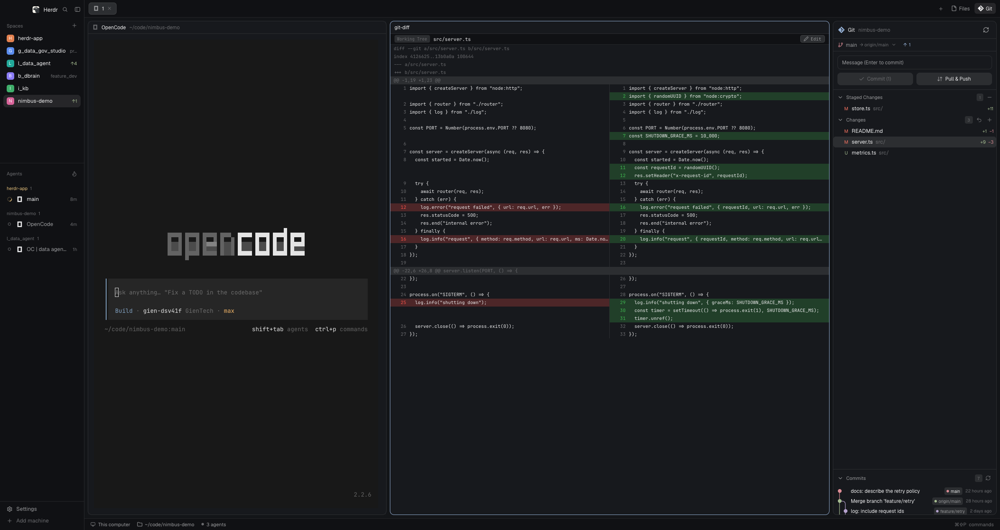

# Herdr Desktop Mods

A set of custom Herdr mods plus a window layout (named `herdr-git`) that
assembles them: a Git-centered workspace — the left sidebar keeps spaces and
agents, the right sidebar is a stack of Files / Changes / a VS Code-shaped Git
panel (commit box, staged and changed files, the branch with its upstream, a
commit graph), the tab bar carries Files / Changes / Git buttons, the status
bar's branch is a button — and beyond Git: a fuller file manager (selection,
context menu, rename/copy/paste/delete), an agents list led by each row's
status, and the reworked tab bar and status bar. The main area shows terminal
panes, with diffs and file editing opening in the tab as panes of their own.



The preview shows a demo repository (`main`, one commit ahead of `origin/main`,
one staged file, two changed, one untracked), the `opencode` agent in the top
pane, and the diff pane comparing `src/server.ts` below.

Package shape: `layouts/herdr-git.json` plus the seven `mods/` folders it
uses. It mirrors a Herdr config folder (default `~/.config/herdr-app/`): copy
the layout and the mod folders into place, then
`herdr-app do layout.switch --name herdr-git`. Built and tested on macOS
against Herdr 0.1.13.

## What you see

Sizes are design px (zoom scales them; the preview is at zoom 1, a 2393×1269
window). Colors are theme token names — the layout sets none of its own, so
the theme picker / settings.json decides the look (the preview: `graphite`,
dark).

Window:

- `titlebar: none`; on macOS the traffic lights are drawn by the system over
  the layout at `[12, 16]`. Root background `canvas`; every boundary is a
  1 px `border` divider. The sidebar width and the right panel width drag
  (the sidebar and work columns set `resizable: false`, so the brand bar,
  tab bar, status bar and their siblings have fixed heights).

Left sidebar — 268 px wide by default (min 44, max 480; the preview's state:
201), background `chrome`:

- Brand bar, 46 px (shipped mod `workspace-chrome`, `window_drag: true`):
  the Herdr mark, a search button, a sidebar-fold button.
- Spaces list (shipped mod `spaces`): one row per space grouped by machine,
  the active row `selected`; rows carry the space's branch chip and — with
  worktree spaces — repo/branch/ahead-behind (the preview: `nimbus-demo ↑1`).
- Agents list (mod `agents-left`, a fork of the shipped `agents`): grouped by
  space (or by priority view: "Needs you" / "Done" / "Working" / "Idle").
  Each row leads with a fixed 14 px status slot, then the program icon, the
  name and the age.
- Footer, 69 px (shipped `workspace-chrome`, `props {footer: true}`):
  Settings and Add machine.

Work column:

- Tab bar, 42 px (mod `tabs-git`, a fork of the shipped `tabs`), background
  `chrome`, `window_drag: true`. Left: tab pills 29 px tall (`raised` +
  1 px `border` when active; the program's icon and name, `Z` when zoomed,
  a spinner while its agent works, a red/green dot for blocked/done, a close
  X on the active pill); a `+` button (shipped `new-menu` popup). Right:
  `Files` / `Changes` / `Git` buttons (`selected` when its panel shows; icons
  `mods/files/file.svg`, `mods/changes/changes.svg`, `mods/git/git.svg`),
  and on Windows min/max/close window buttons (`mods/tabs-git/win-*.svg`).
  On macOS the left padding grows so the traffic lights never overlap a tab.
- Main area — the block `main`, `content: {tab: "active"}`: the active tab's
  terminals as cards. 8 px padding around the row, 8 px gap between panes,
  radius 10, 1 px `border`, and the focused pane swaps its border to 1 px
  `accent`. Every pane keeps a 30 px header (shipped example mod `pane`,
  `reveal: "always"`, `lone: true` so a tab's single pane is framed too):
  program/app + live folder + agent status on the left, split / zoom / close
  on the right. Terminal text uses the mono font from settings (JetBrains
  Mono here), `terminal_padding [14, 12]`.
- Right panel — 368 px by default (min 280, max 900; the preview: 392): one
  stack, `panel-body`, holding three blocks — `files-menu`, `changes`
  (shipped), `git` — one shown at a time; the layout's default child is
  `git`. The tab bar's buttons switch it, or hide the whole column.
- Status bar, 28 px (mod `status-branch`, a fork of the shipped
  `workspace-status`), background `chrome`, top `border`: "This computer"
  (a server icon on a remote space), the branch as a button, "N agents ·
  M needs you", and a palette hint read from the user's actual binding.

The Git panel (mod `git`), top to bottom:

- Header: `Git`, the repo folder, a refresh button.
- Branch row: the branch colored by its lamp, `→ origin/main`, `↑1` / `↓n`
  ahead-behind (click pushes / pulls; pull is `--ff-only`), and a caret that
  drops the branch list (Local / Remote groups; multi-select narrows the
  history to the commits those branches reach).
- Commit box: "Message (Enter to commit)" placeholder; `Commit` (with
  nothing staged it stages everything — a smart commit; `Commit (n)` shows
  the staged count) and `Pull & Push` — not a commit, so it works with an
  empty message: pull `--rebase --autostash`, then push (a diverged branch
  is replayed on the upstream's tip, a dirty tree is parked and restored; a
  conflict stops the run, nothing pushed). With no upstream the row shows
  `Publish`, and the button's push half publishes (-u) too. Cmd/Ctrl+Enter
  commits.
- `Staged Changes` / `Changes` groups (collapsible, with a group "discard
  all"): rows show the status letter (M/A/D/U/R/!), the path and `+n −m`;
  hovering reveals stage / unstage / discard buttons; the row of the file
  currently shown in the diff pane reads as selected.
- `Commits`: up to 120 commits from every local and remote branch, newest
  first, each row with a lamp dot and a hand-drawn graph (a line runs dot to
  dot; forks and merges bend with curves). Chips carry the refs on each
  commit. Hovering opens a full card (subject, date, tags, branches);
  clicking opens a surface anchored under the row with the message and the
  changed file names; right-click offers `Copy Hash` and `Create Branch…`.
  The pane's top edge drags to resize it, and the height is remembered.

The diff pane (mod `git-diff`), as in the preview:

- 26 px header: a mode chip (`Working Tree` / `Staged` / `Commit abc1234`),
  the file path, and an `Edit` button for local text files.
- Body: side by side when the pane is ≥ 420 design px wide — old left, new
  right, a 19 px row with a 46 px right-aligned line-number gutter, removed
  lines tinted red and added lines green (`#f85149`/`#3fb950` at ~24% alpha
  in dark themes, `#cf222e`/`#1a7f37` in light, so they keep their hue over
  any background); a removed line and the added line that replaces it share
  a row. Below 420 px, and for a new file (all green) or a deleted one (all
  red), the same lines fold into one full-width unified column. Hunk headers
  and file metadata span the row on `raised` / `dim`.

## How it behaves

Click flows (the two "hand this to a pane" gestures):

- Git → diff: clicking a file row (or a file inside a commit's surface) in
  the Git panel publishes the comparison to shared state (`git.diff`, see
  below) and splits a `git-diff` pane off the focused terminal — or the
  tab's first terminal when a mod pane holds the keyboard — if the tab has
  no diff pane yet. Clicking the file the pane already shows closes the pane
  (the row highlight is the "on" state); another click updates the same
  pane. With no terminal in the tab, the target still publishes but no pane
  opens.
- Files → editor: clicking a file in the Files panel publishes `files.view`
  and splits a `file-view` pane the same way. The pane opens for editing
  right away; a rename/move repoints it, a delete clears it (unsaved edits
  are never dropped: the pane waits).

Editing and saving:

- `file-view`: `Save` sits in its header; the write is refused while the file
  changed on disk since it was read (writeTextFile's snapshot check), and a
  refusal offers `Reload` (discards the draft). Files above 1 MiB or on
  another machine open read-only (a 400 KB head is shown); read-only files
  cannot be saved. A file picked while the editor is modified waits until
  the save.
- `git-diff`'s `Edit` button turns the pane into the same editor for the
  file on disk (a commit's diff included — the editor holds the working-tree
  copy while the diff keeps showing the commit). Leaving with unsaved
  changes takes a second press ("Discard changes?"). After a save it
  refetches the diff.
- Files panel menu: open with the default app (`open` on macOS, `xdg-open`
  on Linux, `powershell` on Windows), open in pane, rename, cut / copy /
  paste, copy path, delete (with a confirmation listing the names); a folder
  also gets New file… / New folder…, and the tree's empty space offers the
  same for the whole folder. Writes never overwrite: a pasted copy takes
  " copy", a name a cut brings along takes " 2", " 3", …. The clipboard is
  shared state (`files.clipboard`), so every panel copy sees it; pasting
  across machines is disabled. Rename/delete tell the `file-view` pane
  (repoint or clear) and bump a shared refresh counter (`files.refresh`)
  other copies watch.

Branch switching:

- The status bar's branch opens a popover listing the repository's local
  branches (the current one highlighted and checked); picking one runs
  `git switch`, with a toast either way. The list is read fresh on every
  open.
- The Git panel's branch row follows the same folder; its dropdown narrows
  the history; clicking the ahead/behind counters pushes or pulls.

Agent status (agent terminals report it; the layout shows it everywhere):

- `working`: a spinner (`mods/workspace-chrome/spinner.svg`, natively
  animated — `.spin(900)`) in the agents list, on the tab pill, and in the
  pane header.
- `blocked`: a red `!` block in the agents list's leading slot (tooltip
  "Needs you"; the priority view's group header spells it out) and a red dot
  on the tab pill. Herdr itself plays a sound / posts a toast.
- `done`: a filled dot; the row stays in Done until viewed (the mod tracks
  `localStorage`), then reads idle.
- `idle`: a hollow dot. Space and tab status is the most urgent of their
  agents (Herdr's own rule; the spaces sidebar shows it).

What moves, what is remembered:

- The sidebar and panel boundaries drag; the main area's panes drag by the
  app's top-center grip; tab pills reorder by dragging one onto another
  (right-click opens the shipped tab menu, double-click renames).
- The right panel is remembered **per space** (`localStorage` "panels" in
  `tabs-git`): switching space shows that space's choice, a space that never
  had one starts with the panel hidden. The Git button is always offered
  (`shared("workspace.panels")` adds whatever else the welcome enabled).
- The Commits pane height (`localStorage` "logHeight"), the sidebar/panel
  widths and the stack child live in the layout's click state
  (`layouts/.state/`).
- Keyboard: Cmd/Ctrl+Enter commits in the Git panel; Escape closes the
  layered thing (discard confirms, branch list, commit surface). No other
  keys are taken — the mods are mouse-first (the popover list in
  `status-branch`, for example, is its own anchored `Popover`).

Watching the folder:

- The Git panel, Files panel and the shipped Changes panel watch the focused
  folder with `watchFolder` and a 10 s timer fallback; every git read uses
  `--no-optional-locks -c core.fsmonitor=false -c diff.autoRefreshIndex=false`
  so the watch never sees our own reads. The diff pane reads only when its
  target changes (or a save reloads it) — it is not a watcher.

## Built from

The layout (`layouts/herdr-git.json`, a clone of the shipped `main`, so it
carries `cloned_from: {name: "main", version: "0.1.13"}`) — abridged to its
ids:

```json
{ "id": "root", "type": "row", "background": "canvas",
  "titlebar": "none", "traffic_lights": [12, 16],
  "terminal_padding": [14, 12], "divider": {"width": 1, "color": "border"},
  "children": [
    { "id": "sidebar", "type": "column", "size": {"px": 268}, "min": 44, "max": 480,
      "background": "chrome", "resizable": false,
      "children": [
        { "id": "brand", "size": {"px": 46}, "window_drag": true,
          "content": {"mod": "workspace-chrome"} },
        { "id": "sidebar-lists", "type": "column", "children": [
          { "id": "spaces", "size": {"weight": 1}, "min": 90,
            "content": {"mod": "spaces"} },
          { "id": "agents", "size": {"weight": 1}, "min": 90,
            "content": {"mod": "agents-left"} } ] },
        { "id": "sidebar-footer", "size": {"px": 69},
          "content": {"mod": "workspace-chrome", "props": {"footer": true}} } ] },
    { "id": "work", "type": "column", "resizable": false, "children": [
      { "id": "tabs", "size": {"px": 42}, "window_drag": true,
        "content": {"mod": "tabs-git"} },
      { "id": "work-body", "type": "row", "padding": 8, "gap": 8, "children": [
        { "id": "main", "content": {"tab": "active", "pane": {
            "gap": 8, "radius": 10, "background": "background", "lone": true,
            "border": {"width": 1, "color": "border"},
            "focus": {"width": 1, "color": "accent"},
            "header": {"content": {"mod": "pane"}, "reveal": "always",
                       "height": 30, "position": "top"} }} },
        { "id": "panel", "type": "column", "size": {"px": 368}, "min": 280, "max": 900,
          "children": [
            { "id": "panel-body", "type": "stack", "active": "git", "children": [
              { "id": "files", "content": {"mod": "files-menu"} },
              { "id": "changes", "content": {"mod": "changes"} },
              { "id": "git", "content": {"mod": "git"} } ] } ] } ] },
      { "id": "status", "size": {"px": 28}, "content": {"mod": "status-branch"} } ] } ] }
```

The seven mods (all under `mods/`, all `"place": "none"` — only the layout
puts them somewhere):

| mod | origin | what it adds |
|---|---|---|
| `git` | new | the Source Control panel |
| `git-diff` | new | the diff/editor pane |
| `file-view` | new | the file editor pane |
| `files-menu` | fork of `files` | multi-select, context menu, rename/copy/paste/delete, git marks |
| `status-branch` | fork of `workspace-status` | the branch button in the status bar |
| `agents-left` | fork of `agents` | the status chip leading each agent row |
| `tabs-git` | fork of `tabs` | Files / Changes / Git panel buttons |

The forks are clones (`mod.clone`), so each carries
`cloned_from: {name, version: "0.1.13"}` in its `mod.json`; build them by
cloning the shipped mod (Herdr keeps a clone across starts; writing into the
shipped folder does not survive) and then:

- `agents-left` — the status is moved to the front of every row in a fixed
  14 px slot (`h_flex().w(14).mr(9)`) so icons and names stay aligned; the
  blocked chip in a row is the compact `!` (background `t.blocked + "26"`,
  tooltip "Needs you") while the priority group header carries the words;
  `working` uses `mods/workspace-chrome/spinner.svg` with `.spin(900)`;
  `done` holds until viewed (`localStorage` "changed", plus "pins" for
  in-flight `terminal.pin`); the header's sort button opens an overlay of
  this mod itself (`{sortMenu: true}`, popup 200×140); rows run
  `terminal.peek`, `terminal.pin`, `pane.focus`, `layout.resize`.
- `files-menu` — added to the shipped Files panel: row selection
  (Cmd/Ctrl-click toggles, Shift-click a range; Cmd-click on macOS), a
  context menu (an overlay of this mod itself, popup 240) that acts on the
  whole selection, and the write operations. Paste naming: " copy", then
  " 2", " 3" …; a cut takes its name along. Shared state: `files.view`
  (below), `files.clipboard`, `files.refresh` (a counter other copies
  watch). Directories list with POSIX `sh` or PowerShell (Windows; the same
  script prints name and kind as NUL-separated pairs), capped at 500 entries
  per folder / 5,000 total / depth 40 (with a dim note when limited); rows
  carry a git letter from `git status --porcelain=v1 -z` (already in the
  panel's refresh); open uses `open` / `xdg-open` / `powershell`; copy path
  uses `pbcopy` / `wl-copy` / `xclip`. Rename/delete notify `file-view` and
  bump `files.refresh`.
- `status-branch` — `workspace-status` plus: the branch in the bar becomes a
  `Popover` (anchor `bottom_left`, list min 200 / max 340 wide, max 320
  tall); opening reads `git for-each-ref --format=%(refname:short)
  refs/heads`; picking runs `git switch <name>` with a toast; the palette
  hint is derived from `keys()` (falls back to the bare word "commands");
  the folder is the active space's first terminal's live `cwd` (or the space
  folder), the same place the bar's branch comes from.
- `tabs-git` — `tabs` plus the three panel buttons and the per-space panel
  memory: `localStorage` "panels" maps space id → `"files" | "changes" |
  "git" | null`; on a space switch it applies the stored choice with
  `layout.select {stack: "panel-body", child}` + `layout.show|hide {id:
  "panel"}` (a space with no memory starts hidden); manual changes are
  recorded back. The enabled set is `shared("workspace.panels")` plus
  `"git"` — the Git button is always offered. It also pads the tab strip for
  the macOS traffic lights using the layout's `traffic_lights` and the
  sidebar width (divided by zoom), and draws Windows window buttons when
  `window().buttons`.

The new mods:

- `git` (≈1,360 lines): everything above — status via
  `git status --porcelain=v1 -z --no-renames --untracked-files=all`, numstat
  for `+n −m`, `git log HEAD --branches --remotes -n 120 --decorate=short`
  for the history (tags and chips parsed from the decoration), the graph
  drawn with `PathBuilder` strokes (rows 24 px, lanes 14 px apart, curve
  radius 7, lamps hashed from the branch name through `ansi6・ansi3・ansi4・
  ansi5・ansi2・ansi1`, remotes borrowing their local branch's lamp),
  commit surfaces read only the commit's trees (message + changed paths, no
  blobs; files capped at 800, body at 4,000 chars), the repo file list
  capped at 2,000 entries. It opens its own overlays: the commit right-click
  menu (popup 250) and `Create Branch…` (dialog 420×216), both closed with
  `closeOverlay(props().overlay)`. It commits with `-m` (or stages all
  first when nothing is staged), pushes (`git push` / `-u origin <branch>`
  when publishing; `git push` otherwise); the commit box's `Pull & Push`
  pulls `--rebase --autostash` then pushes, while the branch row's pull
  counter stays `--ff-only`; it discards a file or `git restore`s a whole
  group (double-press / dialog), and inits with `git init`.
- `git-diff` (≈350 lines): reads `shared("git.diff")`; fetches a byte-capped
  patch (`sh -c 'git ... "$@" | head -c 600000'`, falling back to plain
  `git`), turns unified lines into paired rows and a unified list
  (`buildRows`), caps the rows at 4,000. `NARROW 420` picks the folded
  column; `COMPACT 300` / `TINY 160` let the header drop its chip and button
  labels in narrow panes. Untracked files are read whole and shown all-green
  (`readTextFile`, 400 KB / 4,000 lines cap); new/deleted files stay in one
  column whatever the width. The editor holds the working-tree file with the
  same save-refusal contract as `file-view`.
- `file-view` (≈200 lines): reads `shared("files.view")`; the editor's
  language comes from the extension (ts/tsx→js, toml→yaml, …); read-only
  for remote or >1 MiB files; `close()` releases the editor.

Shared state contract (set by `setShared`, read with `shared`):

- `git.diff` = `{seq, mode: "work"|"staged"|"commit", root, on, path,
  untracked, binary, commit, commitShort}` — `seq` grows with every publish
  so the pane reloads exactly when the target changes; `on` is the remote
  machine name or null.
- `files.view` = `{seq, root, on, path}` — same growing-seq pattern; a
  cleared target (`path: null`) closes the pane.
- `files.clipboard` = `{on, cut, root, entries: [{name, path}]}` or null.
- `files.refresh` = a growing number; the panels re-read the folder when it
  changes.
- `workspace.panels` (read-only here) = the set of panels the welcome
  enabled; `tabs-git` offers those plus `git`.

Commands the mods run: `pane.split` / `pane.close` (the two "open a pane"
flows), `pane.focus`, `terminal.peek` / `terminal.pin`, `tab.select` /
`tab.move` / `tab.rename` / `tab.close`, `layout.select` / `layout.show` /
`layout.hide` / `layout.resize`, `space.select`, `window.minimize` /
`window.maximize` / `window.close`, `app.palette`.

Programs executed (through `exec`, on the space's machine): `git` (every
panel action, with the read flags above), `sh` (POSIX directory listing,
clipboard writes, `open` fallback, the byte-capped patch), `powershell`
(Windows listing / open / paste), `open` / `xdg-open`, `pbcopy` / `wl-copy` /
`xclip`.

Art: every icon is a small SVG in the mod's own folder —
`mods/git/*.svg` (branch, arrows, check, chevrons, close, copy, git, minus,
plus, refresh, tag, undo), `mods/git-diff/*.svg` (chevron-left, disk, pencil),
`mods/file-view/disk.svg`, `mods/files-menu/{chevron-down,chevron-right,
file,folder}.svg`, `mods/tabs-git/win-{close,max,min,restore}.svg`. The forks
also reference shipped assets on purpose: `mods/workspace-chrome/
{spinner,branch,check,monitor,server}.svg`, `mods/pane/close.svg`,
`mods/files/file.svg`, `mods/changes/changes.svg`. The commit graph is drawn
with `PathBuilder`, no images; the diff's red/green are literal hexes (above)
because theme ANSI colors wash out at row alpha. No fonts are bundled — the
mods use `settings().font_family` (JetBrains Mono by default); the layout
sets no fonts either.

## Watch out

- Build the forks with `mod.clone` (or keep their `cloned_from`), and never
  edit a shipped mod folder: Herdr moves edits aside on the next start. The
  layout is a clone of `main` the same way.
- This layout's clicks (sidebar 201, panel 392, stack child `git`, theme)
  live in `layouts/.state/` and override the JSON on this machine; a fresh
  install starts from the JSON defaults (268 / 368, stack `git`).
- The forks depend on shipped assets and shipped mods (`menu`, `new-menu`,
  `pane`, `changes`, `spaces`, `workspace-chrome`). A build that ships its
  own copies must fix the asset paths and the overlay mod names.
- The Git panel and the Files panel anchor their splits on the focused
  terminal's pane — or the tab's first terminal when a mod pane holds the
  keyboard. In a tab with no terminal there is no anchor: the target
  publishes, but no pane opens. Splitting with `pane.split` while the diff
  is focused works exactly like the panel does it.
- Width thresholds are design px, so they are zoom-independent — verify the
  side-by-side/folded switch by resizing the pane, not by changing zoom.
- Bounds to expect: history 120 commits; repo file list 2,000 entries;
  a commit's changed-file list 800; the diff patch 600 KB / 4,000 rows;
  editing caps at 1 MiB (read-only view 400 KB); the file tree 500 entries
  per folder / 5,000 total / 40 levels; an untracked file preview 400 KB.
- Keep the `--no-optional-locks -c core.fsmonitor=false -c
  diff.autoRefreshIndex=false` read flags: without them the
  `watchFolder` loop sees the panel's own git reads and refreshes forever.
- `watchFolder` on Linux skips git-ignored directories and refuses trees
  above 4,096 non-ignored directories; every watcher here also has a 10 s
  timer, so polling is the fallback — keep it.
- macOS specifics: `titlebar: "none"` hides the system title bar, the
  traffic lights sit over the layout at `[12, 16]`, and `tabs-git` grows
  the tab strip's left padding so they never overlap a tab. On Windows the
  bar draws its own buttons from `window().buttons`.
- The commit box commits on Cmd/Ctrl+Enter (plain Enter types a newline in
  the message); the placeholder text says "Enter to commit" — cosmetic.
- Multi-machine: every git/file call carries `{on}` and runs on the space's
  machine; files on another machine open read-only in `file-view`, and the
  diff pane's `Edit` refuses them (`target.on`).
- The right panel's memory is per space and per mod copy
  (`localStorage`), not global: a brand-new space starts with the panel
  hidden — that is by design, the buttons open it.

## Done when

1. `herdr-app check ~/.config/herdr-app/mods/<each of the seven>` passes
   (loads, renders once, exits 0).
2. `layout.switch {name: "herdr-git"}` shows the window: brand bar, spaces
   and agents, tab bar with the three panel buttons, main panes with 30 px
   headers, right stack (default: Git), status bar with the branch.
3. In a repository: the Git panel lists staged/changed files with letters
   and `+n −m`; clicking a file opens the diff pane side by side, the row
   highlights, clicking the same file again closes the pane; shrinking the
   pane under 420 design px folds it to one column; a new file shows one
   green column.
4. Editing: `Edit` in the diff turns it into an editor; a save with the file
   changed underneath is refused with an explanation; the Files panel's
   `file-view` pane does the same; rename from the Files menu repoints the
   open editor, delete clears it.
5. Commit flow: `Commit` with nothing staged stages everything; `Pull &
   Push` works with an empty message (a real commit still needs one),
   rebases a diverged branch and pushes (with no upstream it publishes
   instead); `Publish` still creates the upstream; the history shows the
   new commit and the branch row's `↑n` returns to 0 after a push.
6. Branch flow: the status bar's branch lists the local branches and
   `git switch`es on pick (toast either way); the Git panel's branch
   dropdown narrows the history; the ahead/behind counters push / pull.
7. Panel memory: in one space open `Git`, in another `Files` — switching
   back and forth restores each space's panel; a space that never had one
   starts hidden; the Git button is always present.
8. Agents: a working agent shows the spinner in the list, on its tab and in
   its pane header; a blocked one shows the leading `!` with the "Needs
   you" tooltip; a done one keeps its dot until viewed.
9. A remote space: the panels follow its terminal's folder and run git
   there; its files open read-only.
